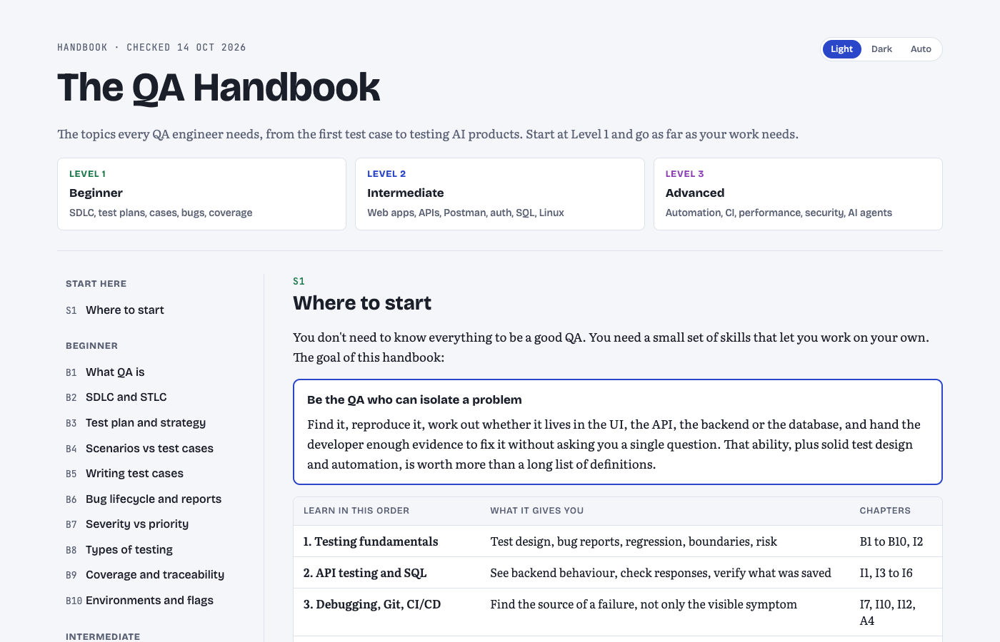

# The QA Handbook

The topics every QA engineer needs, in 36 short chapters: from writing the first test case to testing APIs, databases, security and AI agents.

  

> **Read it online: [chethanbhatbs.github.io/qa-handbook](https://chethanbhatbs.github.io/qa-handbook/)**. No login, no download. Every chapter below links straight to its section.

---

## Chapters (36)

| Part | Chapters | Jump to |
|---|---:|---|
| **Start here** | 1 | [S1 Where to start](https://chethanbhatbs.github.io/qa-handbook/#start) |
| **Beginner** | 10 | [B1 What QA is](https://chethanbhatbs.github.io/qa-handbook/#what) · [B2 SDLC and STLC](https://chethanbhatbs.github.io/qa-handbook/#fit) · [B3 Test plan and strategy](https://chethanbhatbs.github.io/qa-handbook/#plan) · [B4 Scenarios vs test cases](https://chethanbhatbs.github.io/qa-handbook/#scenarios) · [B5 Writing test cases](https://chethanbhatbs.github.io/qa-handbook/#cases) · [B6 Bug lifecycle and reports](https://chethanbhatbs.github.io/qa-handbook/#bugs) · [B7 Severity vs priority](https://chethanbhatbs.github.io/qa-handbook/#sevpri) · [B8 Types of testing](https://chethanbhatbs.github.io/qa-handbook/#types) · [B9 Coverage and traceability](https://chethanbhatbs.github.io/qa-handbook/#coverage) · [B10 Environments and flags](https://chethanbhatbs.github.io/qa-handbook/#envs) |
| **Intermediate** | 12 | [I1 How web apps work](https://chethanbhatbs.github.io/qa-handbook/#webapps) · [I2 Choosing test inputs](https://chethanbhatbs.github.io/qa-handbook/#design) · [I3 API testing](https://chethanbhatbs.github.io/qa-handbook/#api) · [I4 Postman](https://chethanbhatbs.github.io/qa-handbook/#postman) · [I5 AuthN and AuthZ](https://chethanbhatbs.github.io/qa-handbook/#auth) · [I6 SQL and databases](https://chethanbhatbs.github.io/qa-handbook/#sql) · [I7 Browser DevTools](https://chethanbhatbs.github.io/qa-handbook/#devtools) · [I8 Web testing](https://chethanbhatbs.github.io/qa-handbook/#webtest) · [I9 Mobile testing](https://chethanbhatbs.github.io/qa-handbook/#mobile) · [I10 Reading logs](https://chethanbhatbs.github.io/qa-handbook/#logs) · [I11 Exploratory testing](https://chethanbhatbs.github.io/qa-handbook/#explore) · [I12 Git and Linux](https://chethanbhatbs.github.io/qa-handbook/#git) |
| **Advanced** | 13 | [A1 Test automation](https://chethanbhatbs.github.io/qa-handbook/#auto) · [A2 Locators and page objects](https://chethanbhatbs.github.io/qa-handbook/#locators) · [A3 Playwright](https://chethanbhatbs.github.io/qa-handbook/#pw) · [A4 CI and flaky tests](https://chethanbhatbs.github.io/qa-handbook/#ci) · [A5 Performance testing](https://chethanbhatbs.github.io/qa-handbook/#perf) · [A6 Security basics](https://chethanbhatbs.github.io/qa-handbook/#sec) · [A7 Retries and duplicates](https://chethanbhatbs.github.io/qa-handbook/#reliability) · [A8 Testing AI products](https://chethanbhatbs.github.io/qa-handbook/#ai) · [A9 Testing AI agents](https://chethanbhatbs.github.io/qa-handbook/#aiagents) · [A10 Logs, metrics, traces](https://chethanbhatbs.github.io/qa-handbook/#obs) · [A11 Risk and sign-off](https://chethanbhatbs.github.io/qa-handbook/#risk) · [A12 Tools to know](https://chethanbhatbs.github.io/qa-handbook/#tools) · [A13 Word list](https://chethanbhatbs.github.io/qa-handbook/#words) |

---

## How to read

### 1 · In your browser
Open **[https://chethanbhatbs.github.io/qa-handbook/](https://chethanbhatbs.github.io/qa-handbook/)**, or click any chapter link above. The side menu jumps between chapters, and the switch in the top right changes between light and dark mode.

### 2 · On your phone
The page reflows for phone screens. Wide diagrams and tables scroll sideways inside their own box.

### 3 · Offline
Download [`index.html`](index.html) (it is one self-contained file) and open it in any browser. Fonts and the diagram library load from the internet the first time, so the very first open needs a connection.

---

## About the content

Facts were checked against ISTQB, MDN, IETF RFCs, OWASP and vendor docs on 14 Oct 2026.

## Source and design

- `index.html` is the page itself, served by GitHub Pages. Every push to `main` redeploys it.
- `src/` holds the editable source.
- Diagrams are drawn with [rough.js](https://roughjs.com) in the Excalidraw style, using the Virgil font from [Excalidraw](https://github.com/excalidraw/excalidraw) (SIL Open Font License). Code examples are coloured with [Prism](https://prismjs.com).
